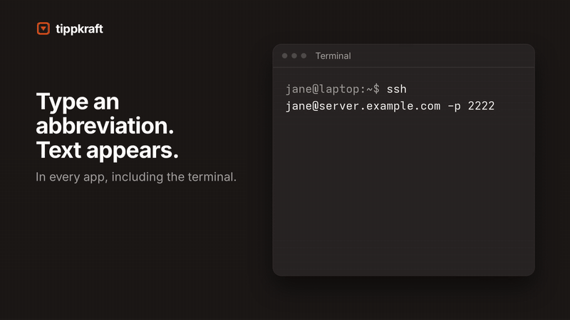

# tippkraft desktop

The desktop client of [tippkraft](https://tippkraft.com), a text expander for Linux on Wayland and X11: type an abbreviation and tippkraft types the snippet, in every app, with your keyboard layout, umlauts and emoji. You manage your snippets in the web app, the desktop client keeps a local copy and works offline.



Works on GNOME, KDE Plasma, Niri, Sway, Hyprland and X11 desktops. Imports snippets from TextExpander and PhraseExpress.

This repository (the desktop client) is open source under the MIT license, so you can check what a program that reads your keyboard actually does. The web app and server are not part of it. [SECURITY.md](SECURITY.md) explains what the client reads, stores and sends.

## Pricing

The desktop client is free. Your snippets live in a tippkraft account:

- **Free:** 1 device, 25 snippets, forever.
- **Pro:** 3 devices, 500 snippets, formatted text. $2.99 / €2.99 per month or $29 / €29 for the first year.
- **Business:** shared company snippets, 5 users included. $19 / €19 per month.

Current details and taxes: [tippkraft.com/en#preise](https://tippkraft.com/en#preise).

## Install

Requirements: Linux x86_64, a Wayland session (GNOME 46+, KDE Plasma 6, Niri, Sway or Hyprland) or an X11 session (Linux Mint Cinnamon, Xfce, MATE and others), your user in the `input` group (`sudo usermod -aG input "$USER"`, then log out and back in), and write access to `/dev/uinput` for that group (the installer prints the udev rule if it is missing).

```sh
curl -fsSL https://tippkraft.com/install.sh | sh
```

The script downloads the latest release from this repository, verifies its SHA-256 checksum and runs `tippkraft setup`. That copies tippkraft to `~/.local/bin`, sets up a systemd user service and opens your browser to connect the app to your tippkraft account. Running it again updates tippkraft. The script never uses sudo, you can [read it here](install.sh).

## Use

- `tippkraft status` shows state, connection and whether an update is available.
- `tippkraft pause` pauses or resumes. Emergency stop: left Ctrl + left Alt + Backspace.
- `tippkraft overview` shows all snippets with a search field.
- `tippkraft connect` connects the app to your account again.
- Keyboard shortcuts: Mod+Alt+T pauses, Mod+Alt+Space shows all snippets. `tippkraft setup` asks once and sets them up on GNOME, KDE Plasma, Cinnamon, Xfce, Niri, Sway and Hyprland (`hyprland.conf`). It never overwrites a combination that is already taken. Elsewhere, or if you said no, it prints the lines to add yourself. `tippkraft setup --shortcuts` asks again.
- Tray icon: left click pauses, right click opens the menu with pause, all snippets and more.

## What it does with your keyboard

- It reads key events through evdev to recognize abbreviations and keeps only the last ~64 characters in memory. Nothing you type is written to disk, logged or sent anywhere.
- It never grabs mice or touch devices, only plain keyboards.
- In programs on your exclusion list (for example password managers) it doesn't trigger at all.
- It talks only to the tippkraft server you connected (by default `https://tippkraft.com`) to fetch your snippets.

Details, file locations and how to report a vulnerability: [SECURITY.md](SECURITY.md).

## Build from source

```sh
cd desktop
cargo build --release
./target/release/tippkraft setup
```

Needs Rust and `libxkbcommon`. Tests: `cargo test` (integration tests create a virtual keyboard via `/dev/uinput`).

`shared/` contains the format contract between server and desktop (`FORMAT.md`, `snippets.example.json`).

## License

MIT, see [LICENSE](LICENSE).
